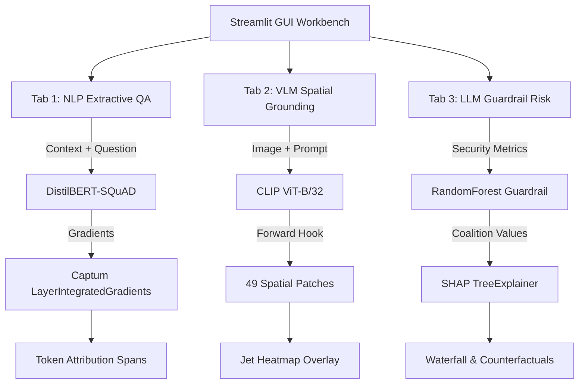

# 🧠 NeuroLens — End-to-End XAI Workbench

[](https://www.python.org/downloads/)
[-EE4C2C.svg?logo=pytorch&logoColor=white)](https://pytorch.org/)
[](https://huggingface.co/)
[](https://streamlit.io/)
[](https://captum.ai/)
[](https://shap.readthedocs.io/)
[](LICENSE)

> **Portfolio-grade Explainable AI workbench demonstrating interpretability across Text, Image, and Tabular modalities.** Built with a strict focus on modern GenAI explainability, zero API key dependencies, and 100% CPU-compatible execution.

---

## 🔬 What is NeuroLens?

NeuroLens is a Streamlit-based interactive workbench that applies state-of-the-art Explainable AI (XAI) methods to three distinct data modalities:

| Tab | Modality | Model | Task | XAI Technique |
|-----|----------|-------|------|---------------|
| 📝 Text | Natural Language | DistilBERT (`distilbert-base-cased-distilled-squad`) | Extractive Question Answering | Dual Layer Integrated Gradients (Captum) |
| 🖼️ Image | Computer Vision | CLIP (`openai/clip-vit-base-patch32`) | Visual Grounding | Spatial Patch Cosine Similarity Heatmap |
| 📊 Tabular | Prompt Security | Scikit-Learn `RandomForestClassifier` | LLM Guardrail Risk Scoring | SHAP TreeExplainer + Live Counterfactuals |

### 🏛️ System Architecture



---

## 📁 Repository Structure

```
Neurolens/
├── app.py                          # Main Streamlit application entry point
├── modules/
│   ├── __init__.py
│   ├── text_saliency.py            # Tab 1: Extractive Q&A + Captum LayerIntegratedGradients
│   ├── vision_grounding.py         # Tab 2: CLIP patch cosine similarity grounding
│   └── tabular_guardrails.py       # Tab 3: RF + SHAP + live counterfactual sliders
├── sample_data/
│   ├── sample_texts.json           # Extractive Q&A benchmark reference pairs
│   └── sample_images/
│       ├── dog_grass.jpg           # Sample image: Dog on grass
│       ├── red_car.jpg             # Sample image: Sports car
│       └── living_room.jpg         # Sample image: Modern living room
├── .gitignore                      # Git exclusion rules for clean commits
├── LICENSE                         # MIT License
├── requirements.txt                # Production Python dependencies
└── README.md                       # Comprehensive documentation
```

---

## 🚀 Quick Start (Running Manually)

### 1. Clone & Set Up Environment

```bash
# Clone the repository
git clone https://github.com/Niranjan070/Neurolens.git
cd Neurolens

# Create and activate a virtual environment
python -m venv .venv

# Windows (Command Prompt / PowerShell)
.venv\Scripts\activate

# macOS / Linux
source .venv/bin/activate
```

### 2. Install Dependencies

```bash
# Install PyTorch (CPU-only — no external GPU needed)
pip install torch torchvision --index-url https://download.pytorch.org/whl/cpu

# Install remaining dependencies
pip install -r requirements.txt
```

### 3. Launch the Workbench

```bash
streamlit run app.py
```

The app will launch at **http://localhost:8501** in your browser.

> **Note:** On first launch, Hugging Face will download the lightweight weights for DistilBERT-SQuAD (~260 MB) and CLIP ViT-B/32 (~350 MB). Subsequent runs are instant due to `@st.cache_resource`.

---

## 🔬 Tab-by-Tab Guide

### Tab 1 — 📝 Text Interpretability (Extractive Q&A + Dual Attribution)

- **Input:** Context paragraph + Question (choose from 3 built-in presets: 🏛️ History, 🤖 AI/ML, 🌍 Science, or enter custom context & question).
- **Inference:** DistilBERT-SQuAD identifies the exact answer token span within the context.
- **Explainability:** 
  - Computes **dual Captum Layer Integrated Gradients** on the DistilBERT embedding layer targeting both the **Start Logit** and **End Logit**.
  - Highlights context tokens in real time (🟢 Green = positive attribution towards the answer, 🔴 Red = negative/inhibiting attribution).
  - Distinguishes extracted answer span with a prominent gold highlight (⭐).
  - Provides interactive bar charts showing top contributing tokens from both the question and context.

**Technique:** `captum.attr.LayerIntegratedGradients` applied to `model.distilbert.embeddings`.

<details>
<summary><b>📐 Formal Mathematical Formulation: Integrated Gradients</b></summary>

$$\text{IG}_i(x) = (x_i - x'_i) \times \int_{0}^{1} \frac{\partial F(x' + \alpha(x - x'))}{\partial x_i} \, d\alpha$$

*(Where $x$ is the input token embedding, $x'$ is the baseline zero-embedding, $\alpha$ denotes the path-integral interpolation parameter, and $\frac{\partial F(\cdot)}{\partial x_i}$ is the gradient of the answer start/end logit with respect to token dimension $i$.)*
</details>

---

### Tab 2 — 🖼️ Image Interpretability (Visual Grounding Heatmap)

- **Input:** Select a sample image (sports car, dog on grass, living room) or upload a custom image (`.jpg`, `.png`).
- **Query:** Enter any descriptive prompt (e.g., *"A red sports car on the road"*).
- **Explainability:**
  - Extracts 49 spatial patch embeddings (7×7 grid) from the final ViT encoder block via a PyTorch forward hook.
  - Projects patch embeddings through CLIP's visual projection head and computes normalized cosine similarities against the text query embedding.
  - Generates a jet colormap heatmap overlay showing where the vision-language model focuses its attention.

**Technique:** Spatial patch activation projection with cosine similarity grounding, bilinearly interpolated onto image coordinates.

<details>
<summary><b>📐 Formal Mathematical Formulation: Patch Cosine Grounding</b></summary>

$$S(p_j, t) = \frac{W_v \cdot p_j \cdot W_t \cdot t}{\Vert{}W_v \cdot p_j\Vert{}_2 \, \Vert{}W_t \cdot t\Vert{}_2}$$

*(Where $p_j$ is the $j$-th spatial token embedding from the ViT encoder ($j \in \{1, \dots, 49\}$), $W_v$ is CLIP's visual projection head, $W_t$ is the text projection head, and $t$ is the text prompt projection).*
</details>

---

### Tab 3 — 📊 Tabular Guardrails (Prompt Risk Scoring & Counterfactuals)

- **Input:** Select safety presets (*Safe Prompt*, *Borderline Query*, *Jailbreak Injection*) or manipulate real-time feature sliders.
- **Explainability:**
  - Evaluates security telemetry features (e.g., `toxic_word_ratio`, `jailbreak_embed_dist`, `token_entropy`, `special_char_freq`).
  - Displays a live Risk Gauge (0–100%) and categorizes threat levels (Low, Medium, High).
  - Renders a **SHAP Waterfall Plot** explaining local contribution: Red bars push the risk score higher, Blue bars pull it lower.
  - Global feature importance analysis using TreeExplainer.

**Innovation:** Enterprise GenAI guardrail framing evaluating prompt injection signals rather than toy legacy datasets.

<details>
<summary><b>📐 Formal Mathematical Formulation: Shapley Additive Attribution</b></summary>

$$\phi_i(v) = \sum_{S \subseteq N \setminus \{i\}} \frac{\vert{}S\vert{}!(\vert{}N\vert{} - \vert{}S\vert{} - 1)!}{\vert{}N\vert{}!} [v(S \cup \{i\}) - v(S)]$$

*(Where $N$ is the set of all input guardrail telemetry features, $S$ is any coalition subset excluding feature $i$, and $v(S)$ represents the characteristic model prediction value conditioned on subset $S$.)*
</details>

---

## 📐 Feature & Capability Matrix

| Capability / Dimension | Implementation Detail |
|-----------------------|-----------------------|
| **Interactive GUI Workbench** | Streamlit multi-tab architecture with reactive controls & real-time analytics |
| **Tabular Interpretability** | RandomForest + SHAP TreeExplainer + dynamic counterfactual sliders |
| **Computer Vision Grounding** | CLIP ViT-B/32 patch cosine similarity spatial attention heatmap |
| **Transformer Text Attribution** | DistilBERT-SQuAD extractive QA + dual Start/End Captum Layer Integrated Gradients |
| **Explainability Visualizations** | Dual-span attribution heatmaps, Jet overlays, SHAP waterfall & global bar charts |
| **Modern GenAI Relevance** | Enterprise LLM guardrail auditing, VLM grounding, deep transformer QA interpretability |
| **100% Local CPU Execution** | Lightweight models architected for fast client-side inference without GPU or API keys |

---

## 🛠️ Technology Stack

| Library | Version | Role |
|---------|---------|------|
| Streamlit | ≥1.32 | GUI workbench framework |
| PyTorch | ≥2.2 (CPU) | Deep learning model inference |
| HuggingFace Transformers | ≥4.40 | DistilBERT-SQuAD + CLIP models |
| Captum | ≥0.7 | Layer Integrated Gradients attribution |
| SHAP | ≥0.45 | TreeExplainer for tabular models |
| Scikit-Learn | ≥1.4 | RandomForestClassifier |
| Pillow | ≥10.0 | Image processing & resizing |
| Matplotlib | ≥3.8 | Explanatory chart & heatmap plotting |
| NumPy / Pandas | ≥1.26 / ≥2.2 | Data processing & tensor manipulation |
| SciPy | ≥1.12 | Spatial interpolation for visual heatmaps |

---

## ⚡ Performance Notes

- First model download: ~30–60 seconds per model depending on internet speed.
- In-memory inference: runs locally on CPU with zero external API calls or secrets.
- Subsequent tab switches: instant caching via Streamlit `@st.cache_resource`.

---

*NeuroLens — Open-Source Explainable AI (XAI) Workbench*
